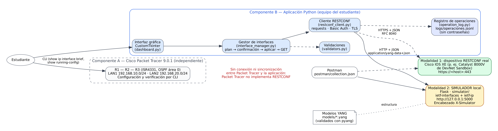

# Automatización y monitoreo de interfaces con YANG, RESTCONF y Python

Proyecto final del curso **CE-5301 Redes de Computadoras** — Instituto Tecnológico de Costa Rica.

Aplicación en Python que consulta, muestra y modifica interfaces de red a través de
una API **RESTCONF** (RFC 8040) usando los modelos YANG **ietf-interfaces** (RFC 8343)
e **ietf-ip** (RFC 8344). Puede trabajar contra un **dispositivo Cisco IOS XE real**
o contra un **simulador local** claramente identificado.

> **Aviso importante.** Cisco Packet Tracer no implementa RESTCONF (se comprobó en
> Packet Tracer 9.0.1, ver [`lab/prueba_restconf_packet_tracer.md`](lab/prueba_restconf_packet_tracer.md)).
> Por eso el laboratorio de Packet Tracer y la aplicación son **componentes
> independientes**: la aplicación **no** se conecta a Packet Tracer y **ningún**
> resultado de este repositorio se obtuvo de un router real. Todas las evidencias
> de API están marcadas como **simuladas**.

---

## Contenido

1. [Arquitectura](#1-arquitectura)
2. [Estructura del repositorio](#2-estructura-del-repositorio)
3. [Instalación (Windows)](#3-instalación-windows)
4. [Dependencias](#4-dependencias)
5. [Configuración](#5-configuración)
6. [Ejecución del simulador](#6-ejecución-del-simulador)
7. [Ejecución de la aplicación](#7-ejecución-de-la-aplicación)
8. [Configuración de un dispositivo RESTCONF real](#8-configuración-de-un-dispositivo-restconf-real)
9. [Pruebas](#9-pruebas)
10. [Postman](#10-postman)
11. [Limitaciones](#11-limitaciones)
12. [Diferencias entre simulación y comunicación real](#12-diferencias-entre-simulación-y-comunicación-real)

---

## 1. Arquitectura



| Componente | Qué es | Cómo se usa |
|---|---|---|
| **A. Laboratorio** ([`lab/`](lab/)) | Topología de 3 routers ISR4331, 2 switches y 2 PC en Packet Tracer 9.0.1, con OSPF ([`topologia_ce5301.pkt`](lab/topologia_ce5301.pkt)) | Configuración y verificación por **CLI** (OSPF convergido y ping PC1 → PC2 verificados) |
| **B. Aplicación** ([`application/`](application/)) | GUI en CustomTkinter + cliente RESTCONF en `requests` | Modo **RESTCONF real** o **Simulador local** |
| **Simulador** ([`simulator/`](simulator/)) | Servidor Flask que implementa un subconjunto de RFC 8040 | Sustituye al dispositivo cuando no hay uno compatible |

Decisiones técnicas principales (detalle en [`docs/arquitectura.md`](docs/arquitectura.md)):

* **Mismo cliente para ambos modos.** El modo solo cambia la etiqueta y los valores por
  defecto; las solicitudes HTTP son idénticas. Así lo que se prueba contra el simulador
  es el mismo código que se usaría contra un router.
* **Configuración y estado separados, como en IOS XE.** La configuración se lee de
  `ietf-interfaces:interfaces` y el estado operativo de `ietf-interfaces:interfaces-state`.
* **PATCH para descripción y habilitación; PUT para la IP.** PATCH (merge) modifica solo
  las hojas enviadas. Para la IP se lee la entrada completa, se sustituye la dirección y
  se envía con PUT (reemplazo), para no acumular direcciones.
* **Confirmación y verificación.** Cada cambio se muestra (método, endpoint y JSON exactos)
  antes de enviarse, y después se ejecuta un GET para verificarlo.
* **Simulador identificado.** Toda respuesta del simulador lleva el encabezado
  `X-Simulator`, la GUI muestra una franja naranja y las evidencias llevan un aviso.

## 2. Estructura del repositorio

```
├── main.py                     Punto de entrada de la aplicación gráfica
├── requirements.txt
├── application/
│   ├── dashboard.py            Interfaz gráfica (CustomTkinter)
│   ├── restconf_client.py      Cliente RESTCONF (requests)
│   ├── interface_manager.py    Lógica: combinar datos, planear, aplicar y verificar cambios
│   ├── validators.py           Validaciones de entrada (IP, prefijo, descripción, conexión)
│   └── operation_log.py        Registro de operaciones (JSONL/CSV, sin contraseñas)
├── simulator/
│   ├── server.py               Arranque del simulador (Flask)
│   ├── routes.py               Recursos RESTCONF y errores RFC 8040
│   ├── data_store.py           Datastore en memoria y validación contra el modelo
│   └── initial_data.json       Datos iniciales (ficticios, inspirados en R1)
├── models/                     ietf-interfaces, ietf-ip y dependencias (.yang)
├── tests/                      Pruebas automatizadas (pytest)
├── postman/                    Colección y entornos de Postman
├── lab/                        Componente A: topologia_ce5301.pkt, configuraciones y verificación
├── scripts/generar_evidencias.py
├── evidence/                   Evidencias generadas (simulador, pruebas, GUI, pyang)
└── docs/                       Arquitectura, dispositivo real, limitaciones, guion
    └── informe/                Informe final en LaTeX (.tex, .pdf, figuras)
```

## 3. Instalación (Windows)

Requisitos: **Python 3.10 o superior** instalado desde python.org con la opción
*tcl/tk and IDLE* marcada (CustomTkinter necesita tkinter).

En PowerShell, desde la carpeta del repositorio:

```powershell
py -3 -m venv .venv
.\.venv\Scripts\Activate.ps1
python -m pip install --upgrade pip
pip install -r requirements.txt
```

Si PowerShell bloquea la activación del entorno:
`Set-ExecutionPolicy -Scope CurrentUser RemoteSigned` (o usar `.\.venv\Scripts\activate.bat` en CMD).

Comprobación rápida:

```powershell
python -c "import tkinter, customtkinter, flask, requests; print('OK')"
```

## 4. Dependencias

| Paquete | Uso |
|---|---|
| `requests` | Cliente HTTP para RESTCONF |
| `flask` | Servidor del simulador |
| `customtkinter` | Interfaz gráfica |
| `pytest` | Pruebas automatizadas |
| `pyang` | Validación de los modelos YANG |

## 5. Configuración

| Parámetro | Simulador (por defecto) | Dispositivo real |
|---|---|---|
| Host | `127.0.0.1` | IP o nombre del dispositivo |
| Puerto | `5000` | `443` |
| Protocolo | HTTP | HTTPS |
| Usuario / contraseña | `admin` / `admin123` | Cuenta con privilegio 15 |
| Verificar TLS | No aplica | Sí; o un archivo CA; o desactivado solo en laboratorio |
| Tiempo de espera | 10 s | 10–20 s |

Las credenciales del simulador se cambian con las variables de entorno `SIM_USER` y
`SIM_PASS`. La contraseña **nunca** se guarda en archivos ni en el registro.

El registro de operaciones se escribe en `logs/operaciones.jsonl` (carpeta ignorada
por git) y puede exportarse a CSV desde la GUI.

## 6. Ejecución del simulador

```powershell
python -m simulator.server
```

Opciones: `--port 5000`, `--host 127.0.0.1`, `--enable-faults` (permite inyectar
errores 500, demoras y respuestas malformadas para demostraciones), `--tls` (HTTPS
autofirmado; requiere `pip install cryptography`).

Recursos implementados:

| Método | Recurso |
|---|---|
| GET | `/restconf` y `/.well-known/host-meta` |
| GET | `/restconf/data/ietf-interfaces:interfaces` |
| GET, PATCH, PUT | `/restconf/data/ietf-interfaces:interfaces/interface={nombre}` |
| GET | `/restconf/data/ietf-interfaces:interfaces-state[/interface={nombre}]` |

Prueba rápida con `curl` (incluido en Windows 10/11):

```powershell
curl.exe -u admin:admin123 -H "Accept: application/yang-data+json" http://127.0.0.1:5000/restconf/data/ietf-interfaces:interfaces
```

El nombre de la interfaz en la URL debe codificarse: `GigabitEthernet0/0/1` →
`GigabitEthernet0%2F0%2F1`.

## 7. Ejecución de la aplicación

Con el simulador corriendo en otra terminal:

```powershell
python main.py              # modo simulador
python main.py --modo real  # modo RESTCONF real
```

Flujo: escribir la contraseña → **Conectar** → la tabla se llena con un GET →
seleccionar una interfaz → **Cambiar descripción**, **Cambiar IP** o
**Habilitar / Deshabilitar** → revisar la solicitud en la ventana de confirmación →
**Confirmar y enviar** → la aplicación hace el GET de verificación y muestra *antes /
después*. El historial inferior registra cada operación.

Capturas: [`evidence/gui/`](evidence/gui/).

## 8. Configuración de un dispositivo RESTCONF real

Resumen para Cisco IOS XE (guía completa, incluida la opción gratuita de **Cisco DevNet
Sandbox**, en [`docs/dispositivo_real.md`](docs/dispositivo_real.md)):

```
configure terminal
 username admin privilege 15 secret <contraseña>
 ip http secure-server
 ip http authentication local
 restconf
end
```

Luego, en la aplicación: modo **RESTCONF real**, host del equipo, puerto 443, HTTPS.

## 9. Pruebas

```powershell
python -m pytest -v
```

Las pruebas levantan el simulador en un puerto libre y se comunican con él por HTTP
real, usando el mismo cliente que la GUI. Último resultado: **39 aprobadas, 5 omitidas**
([`evidence/pruebas/pytest_resultado.txt`](evidence/pruebas/pytest_resultado.txt)).

| Requisito | Prueba |
|---|---|
| 1. GET de interfaces | `test_get.py::test_get_todas_las_interfaces` |
| 2. Interfaz individual | `test_get.py::test_get_interfaz_individual_codifica_la_clave` |
| 3. PATCH de descripción | `test_patch.py::test_patch_descripcion_y_verificacion_con_get` |
| 4. GET posterior | misma prueba + `test_patch_no_altera_otras_hojas` |
| 5. Interfaz inexistente | `test_errors.py::test_interfaz_inexistente_404` |
| 6. Autenticación incorrecta | `test_errors.py::test_credenciales_incorrectas_401` |
| 7. Solicitudes inválidas | `test_errors.py::test_json_mal_formado_400`, `test_validaciones_del_modelo_en_el_servidor`, … |
| 8. Registro de operaciones | `test_patch.py::test_registro_de_operaciones_sin_contrasenas` |
| Extra | 403, 405, 415, 500, timeout, sin conectividad, respuesta malformada, PUT de IP |

**Pruebas contra un dispositivo real** (`tests/test_real_device.py`): se omiten salvo que
se defina `RESTCONF_HOST`:

```powershell
$env:RESTCONF_HOST="<host>"; $env:RESTCONF_USER="<usuario>"; $env:RESTCONF_PASS="<clave>"
$env:RESTCONF_VERIFY="false"   # solo si el certificado es autofirmado
python -m pytest tests/test_real_device.py -v
```

La prueba de escritura requiere además `RESTCONF_ALLOW_WRITE=1` y `RESTCONF_IFACE`, y
restaura la descripción original al terminar.

**Evidencias reproducibles:** `python scripts/generar_evidencias.py` regenera
[`evidence/simulador/`](evidence/simulador/) (13 solicitudes/respuestas, tiempos y registro)
y la colección de Postman.

**Validación YANG:**

```powershell
pyang -p models --strict models/ietf-interfaces.yang models/ietf-ip.yang
pyang -p models -f tree models/ietf-interfaces.yang models/ietf-ip.yang
```

## 10. Postman

Importar [`postman/collection.json`](postman/collection.json) y uno de los entornos:
`entorno_simulador.json` o `entorno_dispositivo_real.json`. Incluye GET de interfaces,
GET de una interfaz, PATCH de descripción, GET de verificación y tres casos de error,
con encabezados, autenticación básica, cuerpos JSON, pruebas automáticas y ejemplos de
respuesta **generados con el simulador**.

## 11. Limitaciones

Detalle y texto para el informe en [`docs/limitaciones.md`](docs/limitaciones.md).

* Packet Tracer no implementa RESTCONF, NETCONF ni servidor HTTP en sus routers.
* No se dispuso de un router físico compatible; el modo real está implementado pero
  **no se ha ejecutado** contra un dispositivo.
* El simulador implementa solo un subconjunto de RFC 8040 (sin `POST`, `DELETE`,
  parámetros de consulta, XML, ETag ni NACM) y sirve por HTTP salvo con `--tls`.
* El simulador admite una sola dirección IPv4 por interfaz y no permite crear interfaces.
* Los datos del simulador son ficticios y se reinician al detenerlo.

## Informe

El informe final está en [`docs/informe/`](docs/informe/): `Informe_Desafio_Redes.tex`
(compilar con pdfLaTeX + Biber, por ejemplo en Overleaf subiendo la carpeta completa)
y el PDF ya compilado. Las secciones marcadas en rojo como **PENDIENTE** requieren datos
que solo el equipo puede aportar (fecha de entrega, enlace del video, minutas, bitácoras
y evidencia del formulario).

## 12. Diferencias entre simulación y comunicación real

| Aspecto | Simulador local | Dispositivo IOS XE real |
|---|---|---|
| Origen de los datos | `simulator/initial_data.json` (ficticio) | Configuración y estado reales del equipo |
| Transporte | HTTP en 127.0.0.1 (HTTPS opcional, autofirmado) | HTTPS obligatorio, certificado del equipo |
| Autenticación | Usuario fijo de prueba | Usuarios AAA del equipo (privilegio 15) |
| Efecto de un cambio | Solo en memoria del simulador | Modifica la *running-config* del router |
| Estado operativo | Calculado: `enabled` y un enlace simulado | Estado físico real del enlace |
| Modelos YANG | ietf-interfaces e ietf-ip (subconjunto) | Cientos de modelos (IETF, OpenConfig, Cisco nativos) |
| Errores | Los mismos códigos y formato RFC 8040 | Mensajes propios de IOS XE |
| Tiempos de respuesta | ~2 ms (local) | Dependen de la red y del equipo |
| Identificación | Encabezado `X-Simulator`, franja naranja | Sin `X-Simulator`, franja azul |
| Relación con Packet Tracer | Ninguna | Ninguna |
