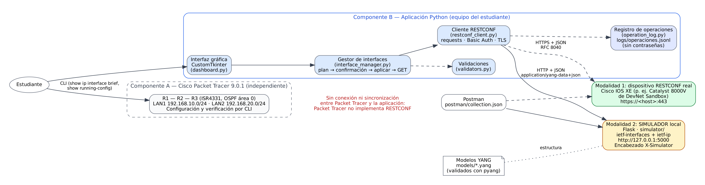
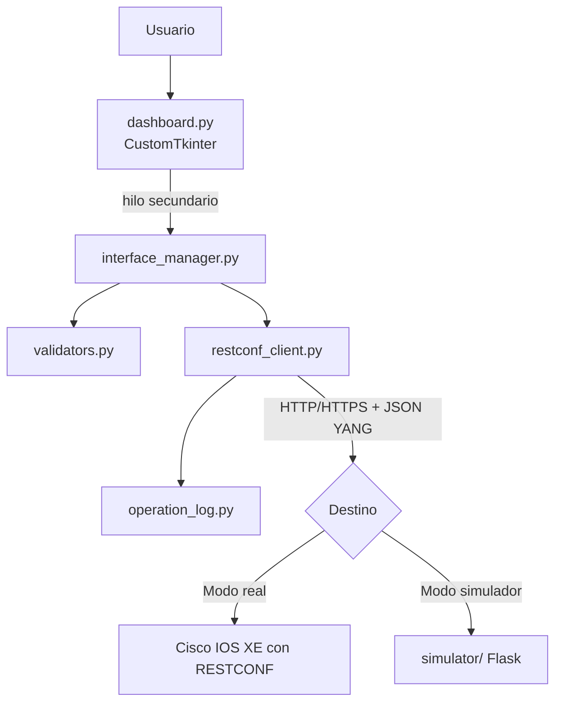

# Arquitectura y decisiones técnicas

Fuente editable: [`img/arquitectura.dot`](img/arquitectura.dot) (Graphviz:
`dot -Tpng -Gdpi=150 arquitectura.dot -o arquitectura.png`).

## Capas de la aplicación

| Módulo | Responsabilidad | No hace |
|---|---|---|
| `dashboard.py` | Ventana, formularios, confirmaciones, tablas e historial | No arma URLs ni JSON |
| `interface_manager.py` | Combina configuración y estado; planea, aplica y verifica cambios | No conoce detalles HTTP |
| `restconf_client.py` | Solicitudes, autenticación, TLS, *timeouts*, clasificación de errores | No interpreta el modelo |
| `validators.py` | Valida datos del usuario antes de enviarlos | No sustituye la validación del dispositivo |
| `operation_log.py` | Fecha, modo, operación, método, endpoint, código, resultado, tiempo | Nunca guarda contraseñas ni cuerpos |

## Decisiones

### 1. Un solo cliente para los dos modos
El modo (*Simulador local* / *RESTCONF real*) solo cambia valores por defecto, la
etiqueta del registro y el color de la franja superior. Las solicitudes son las
mismas, de modo que las pruebas contra el simulador ejercitan el código que se
usaría con un router. Si en modo real responde un servidor con el encabezado
`X-Simulator`, la GUI lo advierte.

### 2. Configuración y estado por separado
RFC 8343 (arquitectura NMDA) coloca `oper-status` dentro de `/interfaces` y marca
`/interfaces-state` como obsoleto (*deprecated*; `pyang -f tree` lo muestra con
`x`). Cisco IOS XE, sin embargo, devuelve la configuración en
`ietf-interfaces:interfaces` y el estado en `ietf-interfaces:interfaces-state`. El
simulador reproduce ese comportamiento y la aplicación combina ambas respuestas. Si
el dispositivo no ofrece el estado, la aplicación muestra los datos de
configuración y lo indica.

### 3. Representación de la dirección IPv4
`ietf-ip` permite `prefix-length` o `netmask` (*choice* `subnet`). IOS XE responde
con `netmask`, así que el simulador guarda `netmask` y acepta ambas formas. La
aplicación convierte a prefijo para mostrarlo.

### 4. PATCH o PUT
| Cambio | Método | Motivo |
|---|---|---|
| Descripción | PATCH | Merge: solo se envía la hoja que cambia |
| Habilitar / deshabilitar | PATCH | Igual; hoja `enabled` |
| Dirección IPv4 | PUT | La lista `address` usa `ip` como clave: un merge con otra IP agregaría una entrada en vez de reemplazarla. Se lee la entrada completa, se cambia la dirección y se reemplaza |

El PUT envía la entrada completa leída del dispositivo (incluida la hoja
obligatoria `type`), por lo que no se pierden la descripción ni el estado.

### 5. Codificación de la clave en la URL
Los nombres como `GigabitEthernet0/0/1` contienen `/`. RFC 8040 (3.5.3) exige
codificar la clave: `interface=GigabitEthernet0%2F0%2F1`. Lo hace
`restconf_client.interface_path()` y lo comprueba una prueba.

### 6. Confirmar antes, verificar después
`interface_manager` produce un `ChangePlan` con el método, el endpoint y el cuerpo
exactos. La GUI lo muestra y solo lo envía tras la confirmación. Después hace un
GET y compara las hojas esperadas; si no coinciden, informa *"enviado pero NO
verificado"*.

### 7. Manejo de errores
El cliente nunca lanza excepciones de red hacia la GUI: devuelve un
`RestconfResult` con `error_kind`:

| `error_kind` | Causa | Ejemplo de mensaje |
|---|---|---|
| `http` | Código 4xx/5xx; se extrae `error-message` de `ietf-restconf:errors` | 400, 401, 403, 404, 405, 415, 500 |
| `timeout` | Sin respuesta en el tiempo configurado | "Tiempo de espera agotado (10 s)" |
| `connection` | Host inalcanzable, puerto cerrado | "No se pudo conectar con …" |
| `tls` | Certificado no válido | "Error TLS: no se pudo validar el certificado" |
| `malformed` | Respuesta 2xx que no es JSON o sin la estructura YANG esperada | "Respuesta malformada" |

### 8. Simulador
* Errores con el formato de RFC 8040 §7.1 (`error-type`, `error-tag`,
  `error-message`).
* Valida el cuerpo contra la estructura de los modelos: hojas desconocidas, hojas
  de solo lectura, tipos, clave que no coincide con la URI, IPv4 válida, máscara
  contigua, dirección de red/broadcast, superposición con otras interfaces y
  longitud máxima de la descripción (200 caracteres, como IOS).
* `GigabitEthernet0` está protegida para poder demostrar el error 403.
* `/simulator/fault` (solo con `--enable-faults`) inyecta errores 500, demoras o
  JSON truncado. Esta ruta **no** forma parte de RESTCONF.
* No hay sincronización con Packet Tracer.

### 9. Interfaz gráfica sin bloqueos
Las llamadas de red se ejecutan en hilos y el resultado vuelve al hilo de Tk con
`after(0, …)`. Mientras hay una operación en curso, los botones se deshabilitan.
