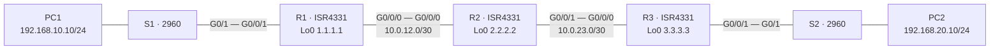

# Componente A — Laboratorio en Cisco Packet Tracer

> Este componente representa la infraestructura de red. Se configura y verifica
> **únicamente por CLI**. Los routers de Packet Tracer **no implementan RESTCONF**
> (ver [`prueba_restconf_packet_tracer.md`](prueba_restconf_packet_tracer.md)),
> por lo que la aplicación Python **no se conecta** a este laboratorio.

## Topología

```
        LAN1 192.168.10.0/24                                        LAN2 192.168.20.0/24
 PC1 ── S1 ── G0/0/1 [R1] G0/0/0 ──── G0/0/0 [R2] G0/0/1 ──── G0/0/0 [R3] G0/0/1 ── S2 ── PC2
 .10   2960     .1         .1  10.0.12.0/30  .2         .1  10.0.23.0/30  .2         .1   2960   .10
```



Enrutamiento dinámico: **OSPFv2, proceso 1, área 0**. Las interfaces de LAN se
declaran `passive-interface` para no enviar mensajes OSPF hacia los usuarios.

## Dispositivos

| Dispositivo | Modelo en Packet Tracer | Función |
|---|---|---|
| R1, R2, R3 | ISR4331 (IOS XE 16.6.4 según `show version`) | Enrutamiento OSPF |
| S1, S2 | 2960-24TT | Conmutación de acceso de cada LAN |
| PC1, PC2 | PC-PT | Equipos finales |

Se eligió el **ISR4331** porque es el router de Packet Tracer que reporta IOS XE
y porque sus nombres de interfaz (`GigabitEthernet0/0/x`) coinciden con los que
usa el simulador RESTCONF. Esto facilita la comparación manual, pero **no
implica ninguna conexión entre ambos**.

## Plan de direccionamiento

| Dispositivo | Interfaz | Dirección IP | Máscara | Descripción |
|---|---|---|---|---|
| R1 | G0/0/0 | 10.0.12.1 | 255.255.255.252 (/30) | Enlace WAN hacia R2 |
| R1 | G0/0/1 | 192.168.10.1 | 255.255.255.0 (/24) | Puerta de enlace LAN1 |
| R1 | G0/0/2 | — | — | Sin uso (shutdown) |
| R1 | Loopback0 | 1.1.1.1 | 255.255.255.255 (/32) | Router-ID OSPF |
| R2 | G0/0/0 | 10.0.12.2 | 255.255.255.252 (/30) | Enlace WAN hacia R1 |
| R2 | G0/0/1 | 10.0.23.1 | 255.255.255.252 (/30) | Enlace WAN hacia R3 |
| R2 | G0/0/2 | — | — | Sin uso (shutdown) |
| R2 | Loopback0 | 2.2.2.2 | 255.255.255.255 (/32) | Router-ID OSPF |
| R3 | G0/0/0 | 10.0.23.2 | 255.255.255.252 (/30) | Enlace WAN hacia R2 |
| R3 | G0/0/1 | 192.168.20.1 | 255.255.255.0 (/24) | Puerta de enlace LAN2 |
| R3 | G0/0/2 | — | — | Sin uso (shutdown) |
| R3 | Loopback0 | 3.3.3.3 | 255.255.255.255 (/32) | Router-ID OSPF |
| PC1 | FastEthernet0 | 192.168.10.10 | 255.255.255.0 | Gateway 192.168.10.1 |
| PC2 | FastEthernet0 | 192.168.20.10 | 255.255.255.0 | Gateway 192.168.20.1 |

## Cableado

| Desde | Puerto | Hacia | Puerto | Cable en Packet Tracer |
|---|---|---|---|---|
| R1 | G0/0/0 | R2 | G0/0/0 | Copper Cross-Over |
| R2 | G0/0/1 | R3 | G0/0/0 | Copper Cross-Over |
| R1 | G0/0/1 | S1 | G0/1 | Copper Straight-Through |
| R3 | G0/0/1 | S2 | G0/1 | Copper Straight-Through |
| S1 | Fa0/1 | PC1 | FastEthernet0 | Copper Straight-Through |
| S2 | Fa0/1 | PC2 | FastEthernet0 | Copper Straight-Through |

## Procedimiento

1. Colocar los dispositivos y conectarlos según la tabla de cableado.
2. En cada router nuevo, responder `no` al diálogo inicial y presionar Enter.
3. Abrir la pestaña **CLI** y pegar el archivo correspondiente de
   [`configuraciones/`](configuraciones/) con el botón **Paste** de la ventana
   (Ctrl+V no funciona en la CLI de Packet Tracer).
4. Configurar PC1 y PC2 en *Desktop → IP Configuration* con los datos de la tabla.
5. Esperar a que OSPF converja (unos segundos en tiempo real) y ejecutar las
   verificaciones de [`verificacion.md`](verificacion.md).
6. El archivo ya está guardado como `lab/topologia_ce5301.pkt`; las capturas
   de pantalla van en `evidence/packet_tracer/`.

### Verificación realizada

El 25 de noviembre de 2026 se armó la topología completa en Packet Tracer 9.0.1
y se guardó como [`topologia_ce5301.pkt`](topologia_ce5301.pkt):

* Los archivos `R1.txt`, `R2.txt`, `R3.txt`, `S1.txt` y `S2.txt` se pegaron en
  la CLI **sin ningún mensaje `% Invalid input`**.
* OSPF convergió: R2 tiene a 1.1.1.1 y 3.3.3.3 en estado `FULL`, y R1 y R3
  aprenden las redes remotas (incluidas las dos LAN).
* `ping` de PC1 (192.168.10.10) a PC2 (192.168.20.10): 3 de 4 respuestas (el
  primer eco se pierde por ARP), `TTL=125`.
* `tracert` de PC1 a PC2: 192.168.10.1 → 10.0.12.2 → 10.0.23.2 → 192.168.20.10.

Salidas completas: [`../evidence/packet_tracer/salidas_cli.md`](../evidence/packet_tracer/salidas_cli.md).

## Archivos

| Archivo | Contenido |
|---|---|
| [`configuraciones/R1.txt`](configuraciones/R1.txt), `R2.txt`, `R3.txt` | Configuración completa de cada router |
| [`configuraciones/S1.txt`](configuraciones/S1.txt), `S2.txt` | Configuración básica de los switches |
| [`verificacion.md`](verificacion.md) | Comandos de verificación y qué observar |
| [`comparacion_cli_vs_aplicacion.md`](comparacion_cli_vs_aplicacion.md) | Procedimiento para comparar CLI y aplicación |
| [`prueba_restconf_packet_tracer.md`](prueba_restconf_packet_tracer.md) | Prueba de compatibilidad RESTCONF en Packet Tracer |
